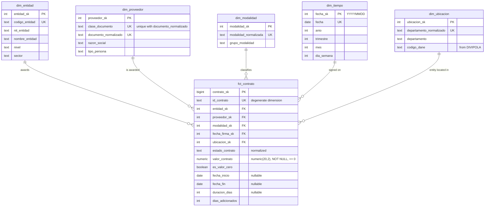

# SECOP II Public Procurement Analytics

An end-to-end ELT pipeline that extracts Colombian public contracts from the SECOP II open-data API (`datos.gov.co`, dataset `jbjy-vk9h`), loads them into PostgreSQL, cleans and models them as a star schema, and answers quantitative questions about supplier concentration with analytical SQL (CTEs and window functions). Results are presented in a Power BI report.

**Main question:** what share of the awarded value is concentrated in what share of suppliers, and how does that concentration vary by contracting entity, selection modality and department?

**Result:** *pending*. The headline figure ("X% of the awarded value is concentrated in Y% of the suppliers") and the Herfindahl-Hirschman Index will be published here once the analysis stage is complete.

**Stack:** PostgreSQL · SQL · Python · Pandas · Power BI

**Report:** *pending*


---

<details open>
<summary><b>1. Project status</b></summary>

<br>

| Stage | Status | Notes |
|---|---|---|
| Environment and exploration | Complete | Database and Python environment ready; API explored; scope confirmed; dimensional model designed |
| Extraction | Pending | |
| Staging | Pending | |
| Transformation | Pending | |
| Dimensional model | In progress | Design complete (section 5); DDL and population pending |
| Analysis | Pending | |
| Power BI report | Pending | |

- **Extracted scope:** whole country, contracts signed 2022–2025: 3,442,281 rows by SoQL count (2026-11-07), 254 of which are duplicate copies of another contract.
- **Last update:** 2026-11-07
- **Known limitations:**
  - The source has no DANE code column. The DANE department codes for the map come from a DIVIPOLA seed file, joined by department name.
  - According to the source description, `departamento` is where the contracting entity is registered, not where the work is done. The map therefore shows contracting by entity location.
  - The model works at department level; the city field is not used (21.8 % `No Definido` in the sample).
  - 67,103 contracts have no signature date, so they fall outside the date-based scope.
- **Source size (2026-11-07):** dataset `jbjy-vk9h` has 5,687,362 rows and 95 columns in its metadata (whole country, all years). The API leaves null fields out of each row, so individual rows show fewer fields.

</details>

---

<details>
<summary><b>2. Purpose and analysis questions</b></summary>

<br>

### Main business question

What proportion of the total value awarded in public procurement is concentrated in what proportion of suppliers, and how does that concentration vary by contracting entity, selection modality and department?

The answer is a number, computing it correctly requires window functions, defending it takes no specialized domain knowledge, and it matters to the public.

### Complementary questions

The data exploration confirmed that the source has the fields every question needs. Each question will be answered in the analysis stage.

| # | Question | Status | Source fields |
|---|---|---|---|
| 1 | Single-supplier dependence: which entities concentrate most of their spending in their main supplier? | Viable | `nit_entidad`, `documento_proveedor`, `valor_del_contrato` |
| 2 | Direct contracting: what share of each entity's value is awarded through direct contracting, and how does it change over time? | Viable | `modalidad_de_contratacion` (includes a "con ofertas" variant), `fecha_de_firma` |
| 3 | Time evolution: how does contracted value vary year over year, in total and by modality? | Viable | `fecha_de_firma` (four complete years, 2022–2025) |
| 4 | Seasonality: is contract signing concentrated in certain months? | Viable | `fecha_de_firma` |
| 5 | Geographic reach: which departments concentrate the most value, and which suppliers contract in several departments? | Viable, with a caveat | `departamento`, which is where the contracting entity is registered, not where the work is done |
| 6 | Duration: how is contract duration distributed by modality? | Viable | `fecha_de_inicio_del_contrato`, `fecha_de_fin_del_contrato`, `duraci_n_del_contrato` |
| 7 | Outliers: how many contracts have zero or disproportionate value, and how much do they weigh in the total? | Viable | `valor_del_contrato` (0.9 % zeros in the sample, heavy upper tail) |

</details>

---

<details>
<summary><b>3. Results</b></summary>

<br>

*Pending.* Each finding will be listed here with its figure, a report screenshot and a link to the SQL query that produces it.

</details>

---

<details>
<summary><b>4. Architecture</b></summary>

<br>

```
SODA API (datos.gov.co)
        |
        v
  [ EXTRACTION ]       src/extract.py: paginated requests, retries, logging,
        |              one Parquet file per page in data/raw/
        v
  [ STAGING ]          staging.stg_contratos in PostgreSQL, every column TEXT
        |
        v
  [ TRANSFORMATION ]   pure SQL: typing, normalization, deduplication,
        |              population of dimensions and facts
        v
  [ DIMENSIONAL MODEL ] schema dw: dim_entidad, dim_proveedor, dim_modalidad,
        |               dim_tiempo, dim_ubicacion, fct_contrato
        v
  [ ANALYSIS ]         sql/analisis/: CTEs and window functions
        |
        +--> [ EXPLORATION AND VERIFICATION ]  Pandas in notebooks/
        |
        v
  [ PRESENTATION ]     Power BI (cloud PostgreSQL or exported tables)
```

### Why ELT instead of ETL

Raw data lands in a staging table where every column is `TEXT`. Loading therefore never fails on malformed content, and the staging layer stays a faithful copy of the source. All transformation then happens inside PostgreSQL in versioned SQL files, so every type-conversion failure, duplicate and discarded row can be counted and explained. PostgreSQL also processes large volumes on disk through its query planner, while Pandas is limited by available memory.

### Role of Pandas

Pandas is used **only for exploration and verification, never for transformation**:

1. Exploring the initial API sample (column inventory, nulls, cardinality).
2. Exploring results already aggregated by SQL, read with `pd.read_sql`.
3. Cross-verifying key SQL figures by recomputing them on a small sample.

</details>

---

<details>
<summary><b>5. Dimensional model</b></summary>

<br>

**Grain of `fct_contrato`: one contract per row, after deduplication.** `id_contrato` stays in the fact table as a degenerate dimension (`UNIQUE`).

The design is based on the source fields confirmed in the exploration (`notebooks/01_exploracion.ipynb`). The DDL will be implemented in `sql/02_ddl_dimensional.sql`.



### Design rules

**Keys**

- **Surrogate keys** (`*_sk`, generated by PostgreSQL as `IDENTITY`) in every dimension; natural keys are kept as `UNIQUE` columns.
- **Unknown member** (`sk = -1`) in every dimension, so contracts with missing context are kept, counted and referenced with `NOT NULL` foreign keys.

**Fact table**

- **`valor_contrato`**: `numeric(20,2)`, `NOT NULL`, `CHECK (valor_contrato >= 0)`. Contracts whose source value is null, non-numeric or negative are excluded from the fact table and counted in section 10.
- **`es_valor_cero`**: stored flag for zero-value contracts. The rule for disproportionate values is defined in the analysis stage.
- **`estado_contrato`**: normalized (trimmed, lowercased, first letter capitalized) and stored in the fact table. No contract is excluded because of its status.
- **`duracion_dias`**: `fecha_fin − fecha_inicio` in calendar days.
  - `NULL` when either date is missing or the end precedes the start; those cases are counted.
  - Zero-day contracts are kept.
  - There is no fallback to the text field `duraci_n_del_contrato`. It uses five units, 8.5 % of the sample has no number, and its tails are implausible.
  - Duration questions report medians and quartiles.
- **`dias_adicionados`**: copied from the source; negative values are counted.
- **Dates**: only the signature date is a foreign key to `dim_tiempo`. Start and end dates are plain nullable `DATE` columns.

**Dimensions**

- **`dim_tiempo`**: generated with `generate_series` for 2022–2025, plus the unknown member; `fecha_sk` is the date as a `YYYYMMDD` integer.
- **`dim_entidad`**: natural key `codigo_entidad`.
  - The NIT is not the key, because one NIT can group several buying units. In the sample there are 1,035 NITs, 1,249 entity codes and 1,262 names.
  - Each entity gets one name: the most frequent one; ties go to the latest `ultima_actualizacion`, then alphabetical order.
  - `nivel` comes from the source field `orden`.
- **`dim_proveedor`**: natural key (`clase_documento`, `documento_normalizado`), unique together.
  - `clase_documento`:
    - `NIT`
    - `CEDULA` (Cédula de Ciudadanía, Cédula de Extranjería, Tarjeta de Identidad)
    - `OTRO`
  - `documento_normalizado`:
    - For NIT and cédula: digits only. The part after a hyphen is dropped as the check digit, and a value containing letters goes to the unknown member and is counted.
    - For `OTRO`: uppercase alphanumeric.
  - Unknown member: document type `No Definido`, a null document, or nothing valid left after normalization.
  - `tipo_persona` (`NATURAL`, `JURIDICA`, `DESCONOCIDO`) is derived from the document type.
  - `razon_social` is the most frequent spelling. Names are for display only and are never used to merge suppliers.
- **`dim_modalidad`**: natural key `modalidad_normalizada` (source text, trimmed and lowercased).
  - `grupo_modalidad` comes from the seed file `sql/seed/modalidad_grupos.csv`. The groups are:
    - Contratación directa (including its "con ofertas" variant)
    - Régimen especial (including its variant)
    - Mínima cuantía
    - Selección abreviada
    - Licitación pública
    - Concurso de méritos
  - Values missing from the seed go to `Sin clasificar` and are counted.
- **`dim_ubicacion`**: department grain, with 33 departments plus the unknown member.
  - Natural key: the normalized department name.
  - `codigo_dane` comes from the seed file `sql/seed/divipola_departamentos.csv`. It maps each source spelling (column `nombre_fuente`, e.g. `Distrito Capital de Bogotá` or `San Andrés, Providencia y Santa Catalina`) to the department's code in DANE's official DIVIPOLA publication.
  - According to the source description, the department is where the contracting entity is registered, not where the work is done.
  - `No Definido` and null go to the unknown member. Names that match no seed row are counted and listed.

**Left out of the model** (the columns stay in staging):

- **The 9 execution and budget fields and the 6 funding-source fields.** Their values are running figures as of the latest update ("a la fecha"), not fixed attributes of the contract, and no analysis question uses them.
- **`duraci_n_del_contrato`, `ciudad`, `localizaci_n`, `codigo_proveedor` and `tipo_de_contrato`.**
- **The 13 columns that are 90 % or more empty in the sample.**

### Constraints

- `PRIMARY KEY` on every table.
- `FOREIGN KEY` from `fct_contrato` to each dimension, all `NOT NULL`.
- `CHECK (valor_contrato >= 0)` and `valor_contrato NOT NULL`.
- `UNIQUE` on the natural key of each dimension (composite in `dim_proveedor`) and on `id_contrato` in the fact table.
- Indexes on every foreign key of the fact table.

</details>

---

<details>
<summary><b>6. Repository structure</b></summary>

<br>

Files marked *(planned)* are empty placeholders or not created yet; unmarked files are complete.

```
SecopII_project/
├── README.md                          <- this file
├── .gitignore                         <- excludes .env, data/, export/
├── .env.example                       <- environment variable template, no real values
├── environment.yml                    <- Conda environment: Python version and pip install of requirements.txt
├── requirements.txt                   <- pinned Python dependencies
├── Makefile                           <- chains extraction, loading and SQL scripts (planned)
├── src/
│   ├── config.py                      <- reads environment variables (planned)
│   ├── extract.py                     <- paginated extraction from the SODA API (planned)
│   └── load_staging.py                <- loads Parquet pages into stg_contratos (planned)
├── sql/
│   ├── seed/                          <- reference data loaded before the transformation (planned)
│   │   ├── divipola_departamentos.csv <- DANE department codes and the source spellings they match (planned)
│   │   └── modalidad_grupos.csv       <- normalized modality value -> modality group (planned)
│   ├── 01_ddl_staging.sql             <- staging schema and table (planned)
│   ├── 02_ddl_dimensional.sql         <- star schema DDL with constraints (planned)
│   ├── 03_transform_dimensiones.sql   <- populates dimensions (planned)
│   ├── 04_transform_hechos.sql        <- populates fct_contrato (planned)
│   ├── 05_export_powerbi.sql          <- exports model tables for Power BI (planned)
│   └── analisis/                      <- one commented query per question (planned)
├── notebooks/
│   ├── 01_exploracion.ipynb           <- API sample exploration
│   ├── 02_exploracion_dw.ipynb        <- exploration of SQL-aggregated results (planned)
│   └── 03_validacion_cruzada.ipynb    <- Pandas cross-check of SQL figures (planned)
└── dashboard/
    └── capturas/                      <- Power BI screenshots (planned)
```

The seed files are small, versioned CSV files that are maintained by hand. `divipola_departamentos.csv` holds the official DANE codes, copied from DANE's DIVIPOLA publication.

`data/` (Parquet extractions) and `export/` (Power BI tables) are generated at run time and not versioned.

</details>

---

<details>
<summary><b>7. Prerequisites</b></summary>

<br>

| Requirement | Version | Notes |
|---|---|---|
| Conda (Miniforge or Miniconda) | any | Creates the project environment from `environment.yml`; packages come only from conda-forge |
| Python | 3.14 | Installed by Conda inside the `secop` environment |
| PostgreSQL | 18 | Server and `psql` client |
| `make` | any | Optional; every target can also be run manually |
| Git | any | |
| `datos.gov.co` account | — | Needed to generate a free App Token |
| Power BI | Desktop (Windows) or web service | See section 11, Power BI connection |

**App Token:** create an account at `datos.gov.co`, open the developer settings of your profile and create an App Token. Only the token is needed; the secret is not used for read access.

**Cloud database (optional):** *pending*. Instructions will be added if the cloud route is used.

</details>

---

<details>
<summary><b>8. Step-by-step reproduction</b></summary>

<br>

Exact, copyable commands with expected results, added as each stage is implemented. Final checks (row counts and key figures) will be listed at the end of this section.

### 1. Database

Creates an application role without superuser rights and a database it owns, with an explicit locale so the result is the same on any machine. Run as the `postgres` operating-system user:

```bash
sudo -iu postgres psql -v ON_ERROR_STOP=1 <<'SQL'
CREATE ROLE secop_app LOGIN;
CREATE DATABASE secop
  OWNER secop_app
  TEMPLATE template0
  ENCODING 'UTF8'
  LOCALE_PROVIDER builtin
  LOCALE 'C.UTF-8';
SQL
sudo -iu postgres psql -c '\password secop_app'
```

The project connects over TCP (`localhost`) with password authentication. Check that the `host` lines of `pg_hba.conf` use `scram-sha-256`:

```bash
sudo -iu postgres grep -Ev '^\s*(#|$)' /var/lib/postgres/data/pg_hba.conf
```

Test the connection (it asks for the password set above):

```bash
psql -h localhost -U secop_app -d secop -c 'SELECT current_user, current_database(), version();'
```

Expected result: one row with `secop_app | secop | PostgreSQL 18.x ...`.

### 1b. Optional: store the project database on another disk

The scope (about 3.4 million contracts) needs roughly 10–15 GB once staging, the model and indexes are built. If the partition that holds the PostgreSQL data folder is short on space, move only the `secop` database to a tablespace on a larger disk. The disk must use a Linux filesystem (ext4, xfs, btrfs) and be mounted at boot. The role, its password and the connection settings do not change.

Run this before loading any data. `ALTER DATABASE ... SET TABLESPACE` requires that nobody is connected to `secop`. Replace the path with a folder on your disk; it should be outside the repository.

```bash
# Folder owned by the server user; postgres must be able to traverse every parent folder
sudo install -d -o postgres -g postgres -m 700 /mnt/aux/home/pgdata/secop_ts

# Make the PostgreSQL service wait for that disk at boot
sudo mkdir -p /etc/systemd/system/postgresql.service.d
printf '[Unit]\nRequiresMountsFor=/mnt/aux/home/pgdata/secop_ts\n' | sudo tee /etc/systemd/system/postgresql.service.d/mnt-aux.conf
sudo systemctl daemon-reload

# Create the tablespace and make it the default location of secop
sudo -iu postgres psql -v ON_ERROR_STOP=1 <<'SQL'
CREATE TABLESPACE secop_ts LOCATION '/mnt/aux/home/pgdata/secop_ts';
ALTER DATABASE secop SET TABLESPACE secop_ts;
SQL
```

Check:

```bash
sudo -iu postgres psql -c "SELECT d.datname, t.spcname, pg_tablespace_location(t.oid) FROM pg_database d JOIN pg_tablespace t ON t.oid = d.dattablespace WHERE d.datname = 'secop';"
```

Expected result: `secop | secop_ts | <your path>`. To undo it, as `postgres` and with nobody connected to `secop`, run `ALTER DATABASE secop SET TABLESPACE pg_default;` and then `DROP TABLESPACE secop_ts;`.

### 2. Python environment and configuration

Clone the repository, create the Conda environment (Python 3.14 plus the pinned packages in `requirements.txt`) and activate it:

```bash
git clone https://github.com/Dvargasar6/SecopII_project.git
cd SecopII_project
conda env create -f environment.yml
conda activate secop
```

Check that the main packages import:

```bash
python -c "import psycopg, sodapy, pandas, pyarrow, sqlalchemy, dotenv; print('ok')"
```

Create your local configuration from the template and fill in `SOCRATA_APP_TOKEN` and `PGPASSWORD` (the `secop_app` password from step 1):

```bash
cp .env.example .env
```

`.env` is gitignored. The PostgreSQL variables use the standard libpq names (`PGHOST`, `PGUSER`, ...), so `psql` can also use them directly.

*The remaining steps are pending and will be added as each stage is implemented.*

</details>

---

<details>
<summary><b>9. Code explanation</b></summary>

<br>

One entry per file in `src/`, `sql/` and `notebooks/`, describing what it does, the design decisions it contains and the techniques it uses. Entries are added as each file is implemented.

### `notebooks/01_exploracion.ipynb`

Explores the source before the extraction and the model are designed. It reads and counts only; nothing is transformed or loaded.

- **Column inventory** from the API metadata, with the official type of each column. The metadata is the reliable list, because the API leaves null fields out of each JSON row.
- **Profile of a 5,000-row sample**, ordered by `:id` so it is reproducible, though not random. The profile measures nulls, placeholder values such as `No Definido`, cardinality and example values.
- **Field mapping** (`CANDIDATES`): links each role in the model to its source field, and checks that the field exists.
- **Format checks** that measure what the SQL cleaning must handle: non-numeric values, unparseable dates, document formats, and repeated contract ids. Pandas conversions use `errors='coerce'` only to count failures.
- **Server-side SoQL aggregation** for every full-dataset figure: counts by department and year, the scope count, and duplicate ids with `GROUP BY ... HAVING` through `$query`. Only the small results are downloaded.
- **Findings** (section 7): the confirmed fields, the formats to clean, the deduplication rule and the scope decision, with its counts.
- **Numeric columns and duration units** (section 8):
  - Lists the 19 columns the metadata declares as `number`.
  - Extracts the unit after the number in `duraci_n_del_contrato`. The sample has five units: Dia(s) 54.5 %, Mes(es) 36.5 %, plus Año(s), Hora(s) and Semana(s). In 8.5 % of rows the unit has no number in front of it.
- **Duration and money fields** (section 9):
  - Converts the text duration to days, and computes the duration from the start and end dates in calendar days.
  - Counts null, negative, zero and over-ten-year values, and compares the two durations.
  - Result:
    - The dates give a duration for 98.2 % of the sample, the text for 91.5 %.
    - Only 15.5 % of rows agree exactly; the middle half of the differences lies between −2 and +3 days.
    - This is why the model computes duration from the dates.
  - Also counts non-null and non-zero values in the 9 execution and budget fields and the 6 funding-source fields, which were then left out of the model.

</details>

---

<details>
<summary><b>10. Data cleaning and counts per stage</b></summary>

<br>

Rule: no row is discarded without recording the count and the reason.

| Stage | Rows in | Rows out | Discarded | Reason |
|---|---|---|---|---|
| Source (API count for the scope) | 5,687,362 (whole dataset) | 3,442,281 (signed 2022–2025) | 2,245,081 | 1,225,314 signed in 2015–2021; 952,664 signed in 2026 (incomplete year); 67,103 without signature date |
| Extraction (Parquet) | pending | pending | pending | |
| Staging | pending | pending | pending | |
| Deduplication | pending | pending | pending (254 expected) | Exact repeats of the same `id_contrato`, measured at the source |
| Type conversion | pending | pending | pending | Contracts whose `valor_del_contrato` is null, non-numeric or negative |
| Fact table | pending | pending | pending | No further exclusions. Missing location, supplier or modality goes to the unknown member, a missing start or end date leaves `duracion_dias` null, and no status is excluded. |

### Planned cleaning treatments

| Problem | Treatment |
|---|---|
| All fields arrive as text | Explicit conversion to `numeric`, `date` and `integer` in SQL; every failure is counted |
| Contract value | Converted to `numeric(20,2)`. Null, non-numeric or negative values exclude the contract, with the count recorded. Zero values are kept and flagged with `es_valor_cero`. |
| Duplicate contract keys (254 `id_contrato` values appear twice at the source) | Keep one row per `id_contrato`: latest `ultima_actualizacion` first, then lowest source row id (`:id`); dropped copies counted |
| Supplier document formats (dots, spaces, trailing dot, check digit, text) | Document class from the document type (`NIT`, `CEDULA`, `OTRO`). Digits only for NIT and cédula, with the part after a hyphen dropped as the check digit. Uppercase alphanumeric for `OTRO`. Nothing valid left, or type `No Definido`: unknown member, counted. |
| Supplier names spelled in several ways | Most frequent spelling per supplier, for display only; names never merge suppliers |
| One NIT for several buying units | Entities keyed by `codigo_entidad`; one name per entity (most frequent, then latest update, then alphabetical) |
| Department names that do not match DANE spellings | Normalized and joined to `sql/seed/divipola_departamentos.csv`; `No Definido` and null go to the unknown member; unmatched names counted and listed |
| Modality variants (for example "con ofertas") | Normalized and grouped through `sql/seed/modalidad_grupos.csv`; values missing from the seed go to `Sin clasificar` and are counted |
| Contract status in mixed letter case | Trimmed, lowercased and first letter capitalized; no contract excluded by status |
| Two sources of duration (dates and a free-text field with five units) | `duracion_dias` from the start and end dates only. `NULL` when a date is missing or the end precedes the start, counted. Zero days kept. |
| Disproportionate contract values | Flagged and quantified in the analysis stage, never silently removed |

### Assumptions to verify during the transformation

These cases are expected from the exploration but have not been measured on the full scope. Each one will be counted and the result recorded here:

- Supplier documents that include a check digit after a hyphen.
- The same supplier document under more than one document type.
- Entity codes with more than one name, and NITs with more than one entity code.
- Modality values missing from `modalidad_grupos.csv`.
- Department names missing from `divipola_departamentos.csv`.
- Contracts whose end date precedes the start date, and negative `dias_adicionados`.
- Whether the 254 duplicate copies are identical in all 95 source columns.

</details>

---

<details>
<summary><b>11. Power BI connection</b></summary>

<br>

*Pending.* Two routes will be supported and documented:

1. **Cloud database (preferred):** the model is replicated to a hosted PostgreSQL and Power BI connects with read-only credentials over SSL.
2. **Table export (fallback):** model tables are exported to CSV with `sql/05_export_powerbi.sql` and imported into Power BI.

</details>

---

<details>
<summary><b>12. Verification and quality</b></summary>

<br>

*Pending.* Referential integrity checks, count reconciliation and the Pandas cross-validation will be documented here.

</details>

---

<details>
<summary><b>13. Decisions, limitations and next steps</b></summary>

<br>

### Decision log

| Date | Decision | Rationale |
|---|---|---|
| 2026-10-23 | ELT with a `TEXT` staging layer | Loading never fails on content; all cleaning is traceable in SQL |
| 2026-10-23 | Star schema with surrogate keys and unknown member `-1` | Fast joins, `NOT NULL` foreign keys, no contract lost to missing context |
| 2026-10-23 | Pagination ordered by `:id` with one Parquet file per page | Stable pages and resumable extraction |
| 2026-11-06 | Repository named `SecopII_project` | Same name for the local folder and the remote repository |
| 2026-11-06 | Conda environment instead of `venv` | One reproducible environment (`environment.yml`) that pins the Python version independently of the system Python; Python packages still come from `requirements.txt` via pip |
| 2026-11-07 | Database `secop` stored in tablespace `secop_ts` on a secondary disk, instead of moving or symlinking the whole PostgreSQL data folder | Only the project data moves. PostgreSQL records the location and can verify it with SQL, it is reversible with one command, and the system package's folders stay untouched |
| 2026-11-07 | Scope: whole country, contracts signed 2022–2025 (3,442,281 rows) instead of Antioquia only | Allows comparing departments and a map of Colombia in the report. The four years are complete; 2026 is still in progress, and the earlier years have few contracts |
| 2026-11-07 | Fact grain: one contract per row after deduplication, with `id_contrato` as a degenerate dimension | Matches the source record and the analysis questions; the source id stays traceable |
| 2026-11-07 | `dim_entidad` keyed by `codigo_entidad`, not by NIT | One NIT can group several buying units: the sample has 1,035 NITs for 1,249 entity codes |
| 2026-11-07 | `dim_proveedor` keyed by document class plus normalized document; names never used to merge | The document is the only stable identifier; names have many spellings |
| 2026-11-07 | `dim_ubicacion` at department level, with DANE codes from a versioned DIVIPOLA seed file | The source has no DANE code, and the city is often `No Definido`; the map needs official codes |
| 2026-11-07 | Modality groups from a versioned seed file; unmapped values go to `Sin clasificar` | Merges variants such as "con ofertas" in a transparent, reviewable way |
| 2026-11-07 | Duration from start and end dates only; no fallback to the text duration | The dates cover 98.2 % of the sample against 91.5 % for the text; the text mixes five units and has implausible tails |
| 2026-11-07 | Execution, budget and funding-source fields left out of the model (kept in staging) | They are running figures as of the latest update, not fixed attributes of the contract, and no analysis question uses them |
| 2026-11-07 | Contracts with a null, non-numeric or negative value excluded from the fact table (counted); zero values kept and flagged | The value is the measure of every question; zeros are part of the outlier question |

**Scaling to 100× the volume:** *pending.*

**Open questions:** whether contracts not yet in force (status `En aprobación` or `enviado Proveedor`) are excluded from the concentration analysis; to be decided in the analysis stage.

</details>

---

<details>
<summary><b>14. Data source and license</b></summary>

<br>

- **Data:** SECOP II — Contratos Electrónicos, published by Colombia Compra Eficiente on [datos.gov.co](https://www.datos.gov.co/) (dataset `jbjy-vk9h`). Data are subject to the portal's terms of use.
- **Code license:** *pending.*

</details>
