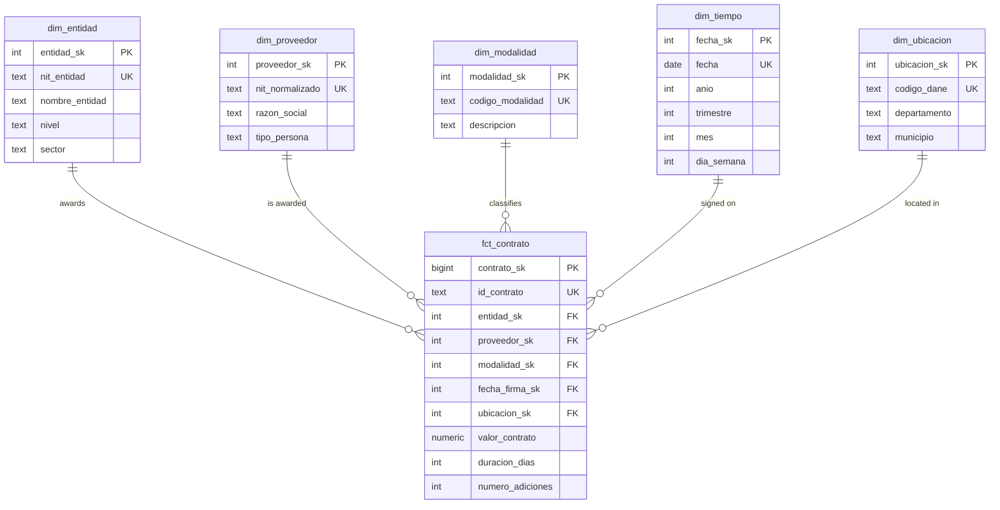

# SECOP II Public Procurement Analytics

An end-to-end ELT pipeline that extracts Colombian public contracts from the SECOP II open-data API (`datos.gov.co`, dataset `jbjy-vk9h`), loads them into PostgreSQL, cleans and models them as a star schema, and answers quantitative questions about supplier concentration with analytical SQL (CTEs and window functions). Results are presented in a Power BI report.

**Main question:** what share of the awarded value is concentrated in what share of suppliers, and how does that concentration vary by contracting entity, selection modality and department?

**Result:** *pending*. The headline figure ("X% of the awarded value is concentrated in Y% of the suppliers") and the Herfindahl-Hirschman Index will be published here once the analysis stage is complete.

**Stack:** PostgreSQL · SQL · Python · Pandas · Power BI

**Report:** *pending*


---

<details open>
<summary><b>1. Project status</b></summary>

<br>

| Stage | Status | Notes |
|---|---|---|
| Environment and exploration | In progress | PostgreSQL database and Python environment ready |
| Extraction | Pending | |
| Staging | Pending | |
| Transformation | Pending | |
| Dimensional model | Pending | |
| Analysis | Pending | |
| Power BI report | Pending | |

- **Extracted scope:** proposed Antioquia, contracts signed 2022–2025; to be confirmed with a SoQL row count.
- **Last update:** 2026-11-06
- **Known limitations:** none recorded yet.

</details>

---

<details>
<summary><b>2. Purpose and analysis questions</b></summary>

<br>

### Main business question

What proportion of the total value awarded in public procurement is concentrated in what proportion of suppliers, and how does that concentration vary by contracting entity, selection modality and department?

The answer is a number, computing it correctly requires window functions, defending it takes no specialized domain knowledge, and it matters to the public.

### Complementary questions

Whether each question can be answered depends on the fields available in the source. Each one will be confirmed or dropped after the initial data exploration.

| # | Question | Status |
|---|---|---|
| 1 | Single-supplier dependence: which entities concentrate most of their spending in their main supplier? | Pending confirmation |
| 2 | Direct contracting: what share of each entity's value is awarded through direct contracting, and how does it change over time? | Pending confirmation |
| 3 | Time evolution: how does contracted value vary year over year, in total and by modality? | Pending confirmation |
| 4 | Seasonality: is contract signing concentrated in certain months? | Pending confirmation |
| 5 | Geographic reach: which departments concentrate the most value, and which suppliers contract in several departments? | Pending confirmation |
| 6 | Duration: how is contract duration distributed by modality? | Pending confirmation |
| 7 | Outliers: how many contracts have zero or disproportionate value, and how much do they weigh in the total? | Pending confirmation |

</details>

---

<details>
<summary><b>3. Results</b></summary>

<br>

*Pending.* Each finding will be listed here with its figure, a report screenshot and a link to the SQL query that produces it.

</details>

---

<details>
<summary><b>4. Architecture</b></summary>

<br>

```
SODA API (datos.gov.co)
        |
        v
  [ EXTRACTION ]       src/extract.py: paginated requests, retries, logging,
        |              one Parquet file per page in data/raw/
        v
  [ STAGING ]          staging.stg_contratos in PostgreSQL, every column TEXT
        |
        v
  [ TRANSFORMATION ]   pure SQL: typing, normalization, deduplication,
        |              population of dimensions and facts
        v
  [ DIMENSIONAL MODEL ] schema dw: dim_entidad, dim_proveedor, dim_modalidad,
        |               dim_tiempo, dim_ubicacion, fct_contrato
        v
  [ ANALYSIS ]         sql/analisis/: CTEs and window functions
        |
        +--> [ EXPLORATION AND VERIFICATION ]  Pandas in notebooks/
        |
        v
  [ PRESENTATION ]     Power BI (cloud PostgreSQL or exported tables)
```

### Why ELT instead of ETL

Raw data lands in a staging table where every column is `TEXT`. Loading therefore never fails on malformed content, and the staging layer stays a faithful copy of the source. All transformation then happens inside PostgreSQL in versioned SQL files, so every type-conversion failure, duplicate and discarded row can be counted and explained. PostgreSQL also processes large volumes on disk through its query planner, while Pandas is limited by available memory.

### Role of Pandas

Pandas is used **only for exploration and verification, never for transformation**:

1. Exploring the initial API sample (column inventory, nulls, cardinality).
2. Exploring results already aggregated by SQL, read with `pd.read_sql`.
3. Cross-verifying key SQL figures by recomputing them on a small sample.

</details>

---

<details>
<summary><b>5. Dimensional model</b></summary>

<br>

**Granularity of `fct_contrato`: one contract per row.**

The diagram below is the proposed design. Column names are provisional until the source fields are confirmed during exploration.



### Design decisions

- **Surrogate keys** (`*_sk`, generated by PostgreSQL) in every dimension; natural keys are kept as `UNIQUE` columns.
- **Unknown member** (`sk = -1`) in every dimension, so contracts without a date or location are kept, counted and referenced with `NOT NULL` foreign keys.
- `dim_tiempo` is generated with `generate_series`, not extracted from the source.

### Constraints

- `PRIMARY KEY` on every table.
- `FOREIGN KEY` from `fct_contrato` to each dimension, all `NOT NULL`.
- `CHECK` that monetary values are non-negative.
- `UNIQUE` on the natural key of each dimension.
- Indexes on every foreign key of the fact table.

</details>

---

<details>
<summary><b>6. Repository structure</b></summary>

<br>

The files are currently empty placeholders and will be implemented stage by stage.

```
SecopII_project/
├── README.md                          <- this file
├── .gitignore                         <- excludes .env, data/, export/
├── .env.example                       <- environment variable template, no real values
├── environment.yml                    <- Conda environment: Python version and pip install of requirements.txt
├── requirements.txt                   <- pinned Python dependencies
├── Makefile                           <- chains extraction, loading and SQL scripts
├── src/
│   ├── config.py                      <- reads environment variables
│   ├── extract.py                     <- paginated extraction from the SODA API
│   └── load_staging.py                <- loads Parquet pages into stg_contratos
├── sql/
│   ├── 01_ddl_staging.sql             <- staging schema and table
│   ├── 02_ddl_dimensional.sql         <- star schema DDL with constraints
│   ├── 03_transform_dimensiones.sql   <- populates dimensions
│   ├── 04_transform_hechos.sql        <- populates fct_contrato
│   ├── 05_export_powerbi.sql          <- exports model tables for Power BI
│   └── analisis/                      <- one commented query per question
├── notebooks/
│   ├── 01_exploracion.ipynb           <- API sample exploration
│   ├── 02_exploracion_dw.ipynb        <- exploration of SQL-aggregated results
│   └── 03_validacion_cruzada.ipynb    <- Pandas cross-check of SQL figures
└── dashboard/
    └── capturas/                      <- Power BI screenshots
```

`data/` (Parquet extractions) and `export/` (Power BI tables) are generated at run time and not versioned.

</details>

---

<details>
<summary><b>7. Prerequisites</b></summary>

<br>

| Requirement | Version | Notes |
|---|---|---|
| Conda (Miniforge or Miniconda) | any | Creates the project environment from `environment.yml`; packages come only from conda-forge |
| Python | 3.14 | Installed by Conda inside the `secop` environment |
| PostgreSQL | 18 | Server and `psql` client |
| `make` | any | Optional; every target can also be run manually |
| Git | any | |
| `datos.gov.co` account | — | Needed to generate a free App Token |
| Power BI | Desktop (Windows) or web service | See section 11, Power BI connection |

**App Token:** create an account at `datos.gov.co`, open the developer settings of your profile and create an App Token. Only the token is needed; the secret is not used for read access.

**Cloud database (optional):** *pending*. Instructions will be added if the cloud route is used.

</details>

---

<details>
<summary><b>8. Step-by-step reproduction</b></summary>

<br>

Exact, copyable commands with expected results, added as each stage is implemented. Final checks (row counts and key figures) will be listed at the end of this section.

### 1. Database

Creates an application role without superuser rights and a database it owns, with an explicit locale so the result is the same on any machine. Run as the `postgres` operating-system user:

```bash
sudo -iu postgres psql -v ON_ERROR_STOP=1 <<'SQL'
CREATE ROLE secop_app LOGIN;
CREATE DATABASE secop
  OWNER secop_app
  TEMPLATE template0
  ENCODING 'UTF8'
  LOCALE_PROVIDER builtin
  LOCALE 'C.UTF-8';
SQL
sudo -iu postgres psql -c '\password secop_app'
```

The project connects over TCP (`localhost`) with password authentication. Check that the `host` lines of `pg_hba.conf` use `scram-sha-256`:

```bash
sudo -iu postgres grep -Ev '^\s*(#|$)' /var/lib/postgres/data/pg_hba.conf
```

Test the connection (it asks for the password set above):

```bash
psql -h localhost -U secop_app -d secop -c 'SELECT current_user, current_database(), version();'
```

Expected result: one row with `secop_app | secop | PostgreSQL 18.x ...`.

### 2. Python environment and configuration

Clone the repository, create the Conda environment (Python 3.14 plus the pinned packages in `requirements.txt`) and activate it:

```bash
git clone https://github.com/Dvargasar6/SecopII_project.git
cd SecopII_project
conda env create -f environment.yml
conda activate secop
```

Check that the main packages import:

```bash
python -c "import psycopg, sodapy, pandas, pyarrow, sqlalchemy, dotenv; print('ok')"
```

Create your local configuration from the template and fill in `SOCRATA_APP_TOKEN` and `PGPASSWORD` (the `secop_app` password from step 1):

```bash
cp .env.example .env
```

`.env` is gitignored. The PostgreSQL variables use the standard libpq names (`PGHOST`, `PGUSER`, ...), so `psql` can also use them directly.

*The remaining steps are pending and will be added as each stage is implemented.*

</details>

---

<details>
<summary><b>9. Code explanation</b></summary>

<br>

*Pending.* One entry per file in `src/`, `sql/` and `notebooks/`, describing what it does, the design decisions it contains and the techniques it uses.

</details>

---

<details>
<summary><b>10. Data cleaning and counts per stage</b></summary>

<br>

Rule: no row is discarded without recording the count and the reason.

| Stage | Rows in | Rows out | Discarded | Reason |
|---|---|---|---|---|
| Source (API count for the scope) | — | pending | — | — |
| Extraction (Parquet) | pending | pending | pending | |
| Staging | pending | pending | pending | |
| Deduplication | pending | pending | pending | |
| Type conversion | pending | pending | pending | |
| Fact table | pending | pending | pending | |

### Planned cleaning treatments

| Problem | Treatment |
|---|---|
| All fields arrive as text | Explicit conversion to `numeric`, `date`, `integer` in SQL |
| Monetary values as strings | Regex cleanup and conversion to `numeric(20,2)` |
| Unnormalized supplier names | Uppercase, accent removal, whitespace collapsing, corporate suffix unification |
| Heterogeneous NIT formats | Digit extraction, check-digit separation, normalized NIT as natural key |
| Mixed or null dates | Safe conversion; invalid values counted and mapped to the unknown member |
| Duplicates from record updates | Keep the most recent version per contract key |
| Zero-value or disproportionate contracts | Flagged and quantified, never silently removed |

</details>

---

<details>
<summary><b>11. Power BI connection</b></summary>

<br>

*Pending.* Two routes will be supported and documented:

1. **Cloud database (preferred):** the model is replicated to a hosted PostgreSQL and Power BI connects with read-only credentials over SSL.
2. **Table export (fallback):** model tables are exported to CSV with `sql/05_export_powerbi.sql` and imported into Power BI.

</details>

---

<details>
<summary><b>12. Verification and quality</b></summary>

<br>

*Pending.* Referential integrity checks, count reconciliation and the Pandas cross-validation will be documented here.

</details>

---

<details>
<summary><b>13. Decisions, limitations and next steps</b></summary>

<br>

### Decision log

| Date | Decision | Rationale |
|---|---|---|
| 2026-10-23 | ELT with a `TEXT` staging layer | Loading never fails on content; all cleaning is traceable in SQL |
| 2026-10-23 | Star schema with surrogate keys and unknown member `-1` | Fast joins, `NOT NULL` foreign keys, no contract lost to missing context |
| 2026-10-23 | Pagination ordered by `:id` with one Parquet file per page | Stable pages and resumable extraction |
| 2026-11-06 | Repository named `SecopII_project` | Same name for the local folder and the remote repository |
| 2026-11-06 | Conda environment instead of `venv` | One reproducible environment (`environment.yml`) that pins the Python version independently of the system Python; Python packages still come from `requirements.txt` via pip |

**Scaling to 100× the volume:** *pending.*

**Open questions:** final extraction scope.

</details>

---

<details>
<summary><b>14. Data source and license</b></summary>

<br>

- **Data:** SECOP II — Contratos Electrónicos, published by Colombia Compra Eficiente on [datos.gov.co](https://www.datos.gov.co/) (dataset `jbjy-vk9h`). Data are subject to the portal's terms of use.
- **Code license:** *pending.*

</details>
